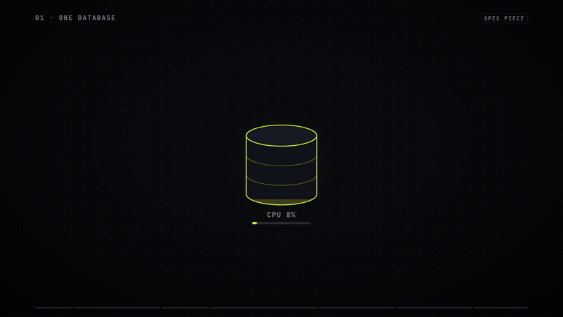

# Why one database hits a wall — and how sharding gets you past it

> **Spec piece.** Not affiliated with or endorsed by PlanetScale. Made as a portfolio piece by **Kentaro Maeda**, with Claude as pipeline engineer. Portfolio: [maeken313.github.io](https://maeken313.github.io)



A 66-second explainer on database sharding, built **entirely in code**: no stock footage, no templates, no hand-placed keyframes. One script file drives the narration, captions, animation timing and sound design, so changing a single line re-times the whole piece.

| | |
|---|---|
| 🎬 Main (16:9, 1080p, 66 s) | [`media/main_1080p.mp4`](media/main_1080p.mp4) |
| 📱 Vertical cut (9:16, 35 s) | [`media/short_9x16.mp4`](media/short_9x16.mp4) |
| 🛠 Making-of (60 s) | [`media/making_of_1080p.mp4`](media/making_of_1080p.mp4) |
| 🖼 Thumbnails | [`A`](media/thumbnail_A.png) · [`B`](media/thumbnail_B.png) |
| 💬 Captions | [`main_en.srt`](media/main_en.srt) · [`short_en.srt`](media/short_en.srt) |

## How it works

```
script.json ──► tts.py (Kokoro TTS) ──► words.py (Whisper QA + word timings) ──► timing.json
                                                                                     │
cues.json  (which word triggers which motion + sound) ◄──────────────────────────────┤
     │                                                                               │
     ├──► anim/  Remotion (React) — every scene, captions, vertical layout ◄─────────┤
     └──► mix.py — procedural SFX + music, ducking, loudness ◄───────────────────────┘
                                   │
                    16:9 main · 9:16 short · thumbnails · SRT
```

- **`script.json` is the only source.** Every line of narration lives here. Lines marked `"short": true` are cut into the vertical version automatically (`segments.py`).
- **AI narration, checked by AI.** Each line is voiced with [Kokoro](https://github.com/thewh1teagle/kokoro-onnx), then transcribed back with Whisper and compared to the script. Mispronunciations (e.g. *Vitess* heard as *Vitis*) are caught by machine and fixed with phonetic hints. The final mix is transcribed again to confirm the voice is not buried under music (98% recognized).
- **Word-level captions** come from Whisper timestamps, not hand timing.
- **One timeline for picture and sound.** `cues.json` says, for example, *"on the word 'split', split the database and play the split sound."* The animation (`anim/src/lib.ts`) and the mixer (`cues.py`) both read it, so they cannot drift.
- **Sound is synthesized in code** (`mix.py`): whooshes, impacts, clicks, a 96 BPM music bed, voice ducking, loudness normalization. Stems are exported for finishing in DaVinci Resolve.
- **QA on stills.** Key frames are rendered to contact sheets and reviewed before every full render. The making-of shows three fixes caught this way.

## Numbers

- ~40 min from script to every output (first full cut)
- 13 min to fix the opening hook and re-render everything
- 2 min 26 s to change one script line, re-voice and re-check it, re-time everything and render the new opening (a full 66 s re-render takes about 5 min more)

## Rebuild

```bash
pip install kokoro-onnx soundfile faster-whisper scipy numpy   # Python 3.10+
# download kokoro-v1.0.onnx and voices-v1.0.bin into tts/
#   https://github.com/thewh1teagle/kokoro-onnx/releases (model-files-v1.0)
python tts.py && python words.py && python segments.py && python mix.py && python srt.py
python mk_audio.py
cp audio/main_mix.wav audio/short_mix.wav anim/public/
cd anim && npm install && npx remotion bundle src/index.ts --out-dir build && ./render.sh
```

Set `CHROME=/path/to/chrome` before `./render.sh` to use a specific browser; otherwise Remotion downloads its own.

## Credits & licenses

- Concept, direction & edit: **Kentaro Maeda** ([@maeken_313](https://www.instagram.com/maeken_313/)). Pipeline and code written with Claude (Anthropic).
- Built with [Remotion](https://www.remotion.dev) (free license for individuals), Kokoro TTS, faster-whisper, ffmpeg.
- Code: MIT. Video, narration and design: © 2026 Kentaro Maeda, all rights reserved.
- *PlanetScale* and *Vitess* are referenced for context only. This is not an official PlanetScale video.
